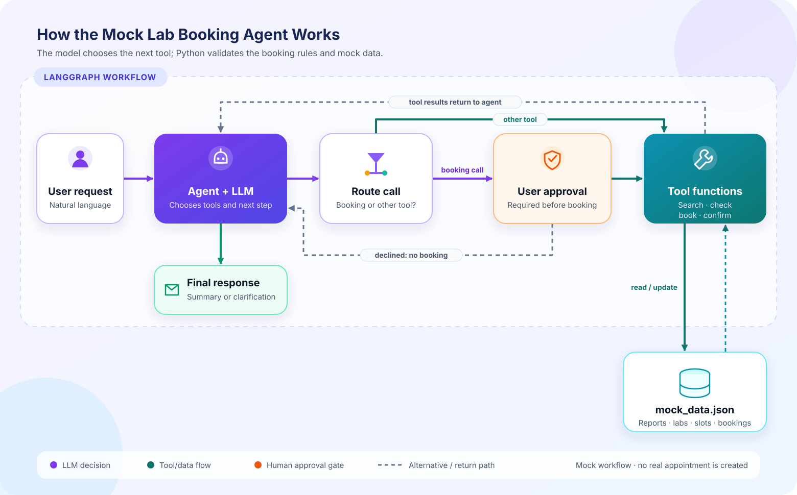

# Mock Lab Booking Agent

## What it does

This CLI uses a LangGraph workflow and an LLM with tool calling to search mock reports and labs, inspect appointment slots, and make a mock booking when the request is clear, supported, and approved by the user. No actual appointment is created and no email or SMS is sent.

## Requirements from the assessment

The implementation defines all six required tools: `search_emails`, `extract_lab_tests`, `search_labs`, `check_availability`, `book_test`, and `send_confirmation`. The model chooses tools based on the request and receives each tool result before choosing its next step. The three required cases are represented in [examples.md](examples.md).

LangGraph's shared message state preserves the conversation and tool results through the agent/tool loop. Before a valid, new `book_test` call, an approval node pauses and shows the exact test, lab, and appointment. An existing duplicate skips approval and is reported as an existing booking. The tool runs only after the user says yes. `mock_data.json` preserves bookings between runs. Python validates exact lab capabilities and slots, requires an availability check during the current request before booking, enforces the earliest checked slot, and blocks another booking for the same lab and exact test. Confirmations are recorded only for new bookings created during the current request. A generic MRI request asks which kind is intended.

## Architecture



The LLM interprets natural language, selects tools, and uses returned facts to decide the next action. Python performs deterministic operations: searching local records, checking exact capabilities, validating slots, enforcing the earliest slot, preventing duplicates, and storing mock confirmations. LangGraph connects the model node to the tools node and routes back to the model while tool calls remain. Its shared `messages` state contains the user request, tool calls, and tool results.

## Files

- `agent.py`: CLI, six LangChain tools, LangGraph state and nodes, and the multi-step agent/tool loop.
- `mock_data.json`: example emails/reports, completed test names, labs and slots, bookings, and mock confirmations.
- `.env.example`: names of the API key and optional model setting.
- `examples.md`: the three assessment requests.

## Setup (PowerShell)

Run these commands from this directory. Python 3.10 or newer is recommended.

```powershell
py -3 -m venv .venv
.\.venv\Scripts\Activate.ps1
python -m pip install --upgrade pip
python -m pip install -r requirements.txt
Copy-Item .env.example .env
notepad .env
```

Replace the placeholder in `.env` with your CodeCraft API key. The defaults are `MODEL_NAME=gpt-5.5` and `BASE_URL=https://codecraftapi.com/v1`. Keep `.env` and the key private; `.gitignore` excludes `.env` when using Git. If uploading files through GitHub's website, do not select `.env`—manual uploads do not apply `.gitignore`. Commit `.env.example` with its placeholder instead. The configured model must support tool calling. The supplied compatibility check confirmed that GPT-5.5 returned a structured tool call through CodeCraft; check your CodeCraft dashboard for current plan allowance and model eligibility.

## Run

```powershell
python .\agent.py "Find my previous tests and book the earliest available Cardiac MRI."
python .\agent.py "Book XYZ Advanced Scan."
python .\agent.py "Book an MRI for me."
```

The successful example pauses before booking, displays the requested test/lab/slot, and asks `Approve this mock booking? Enter yes or no.` Enter `yes` to continue through the booking and mock confirmation tools; any other answer declines. Run the successful example again to see duplicate protection. To reset the mock state after trying scenarios, edit `mock_data.json` and clear its `bookings`, `availability_checks`, and `confirmations` arrays.

## Expected scenario behavior

1. **Successful booking** — The model should call report search and extraction, search for exact `Cardiac MRI`, check the supporting lab's slots, then pause for human approval. After approval, it books `2026-10-20T10:30:00` (the earliest mock slot) and records a mock confirmation. The final summary should distinguish completed tests (`CBC`, `Lipid Profile`, `ECG`) from the new booking and include its returned booking ID.
2. **Unavailable test** — No lab lists `XYZ Advanced Scan`. The model should report no supporting lab and stop before booking. `book_test` independently refuses any unsupported test.
3. **Missing information** — The exact request `MRI` is ambiguous for booking in this example. The CLI asks which type of MRI is intended without calling booking tools.

Tool order and final wording are selected by the model, so phrasing can vary. Python checks make invalid booking calls fail safely even if the model chooses one.

## How the code works

LangChain's `@tool` decorator turns each Python function and its type hints/docstring into a schema the model can call. LangGraph's agent node invokes the model with those tools bound. A conditional edge sends booking calls to the approval node and other tool calls to the tools node. The approval node uses `interrupt()` to pause the graph; the CLI resumes the same thread with the user's yes/no decision. The graph has an in-memory checkpointer for this pause/resume interaction and a recursion limit. If approval is declined, the graph returns a declined tool result to the model without running `book_test`.

Every tool reads the current JSON file so it sees saved bookings. `book_test` checks support, slot validity, and existing bookings before appending a booking. `send_confirmation` stores a local confirmation record only for a confirmed booking. The earliest slot check compares ISO-formatted dates and times, whose ordering matches chronological ordering.

## Libraries and model

- `langgraph`: explicit graph nodes, shared state, and conditional routing.
- LangGraph in-memory checkpointing: holds the current graph state while approval is pending, within the running CLI process.
- `langchain-openai`: OpenAI-compatible chat-model connector configured for CodeCraft with a custom base URL and the Chat Completions API; LangChain `@tool` defines the callable tools.
- Python standard library: loads the simple `.env` file, reads/writes JSON, handles paths, environment variables, and command-line input.
- Provider: CodeCraft API using the OpenAI-compatible chat-completions interface. Model default: `gpt-5.5` (configurable via `MODEL_NAME`); endpoint base: `https://codecraftapi.com/v1` (configurable via `BASE_URL`). Framework: LangGraph.

## Limits

This teaching example uses one local JSON file and an in-memory checkpoint for a single-user CLI demo. The approval pause can resume while that CLI process is running; it does not survive stopping the process. It does not provide real medical services, real email search, live appointment inventory, concurrency control, or a real confirmation channel. A CodeCraft API key and network access are required for an end-to-end LLM conversation.
